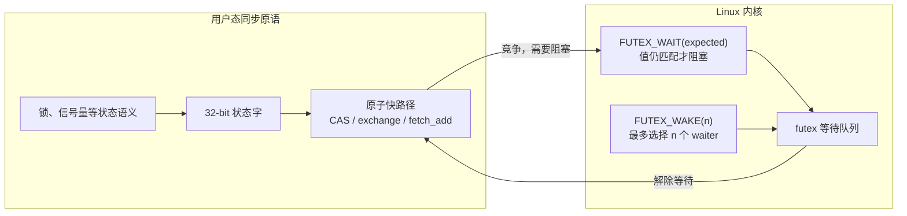
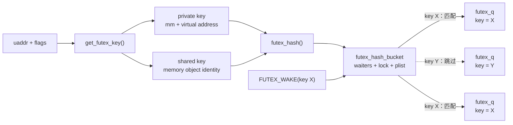
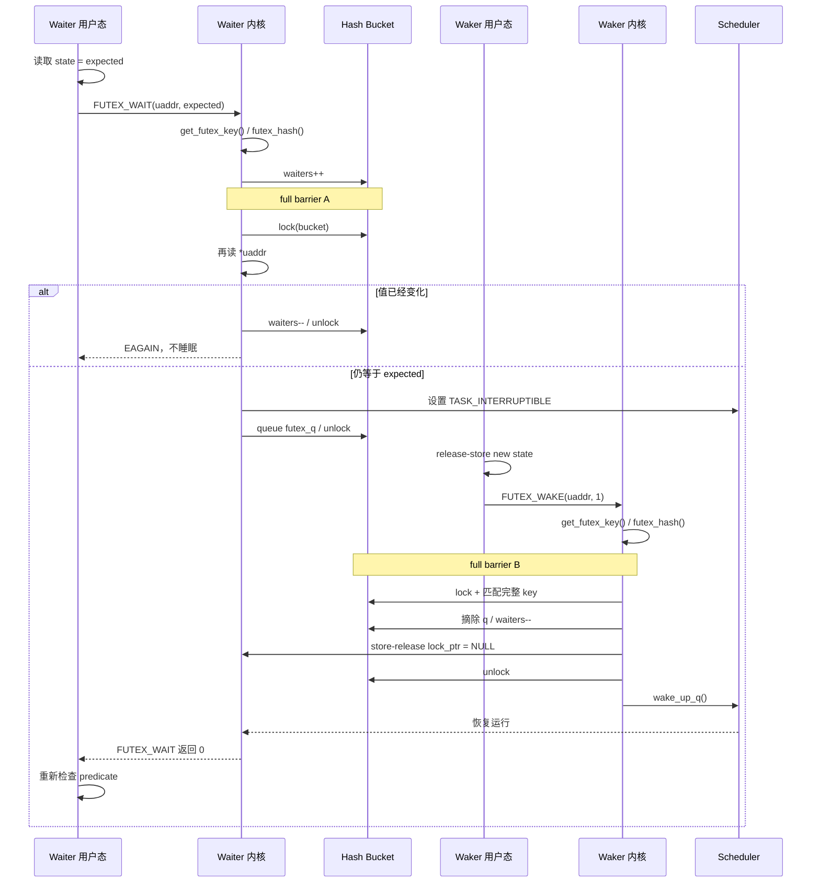
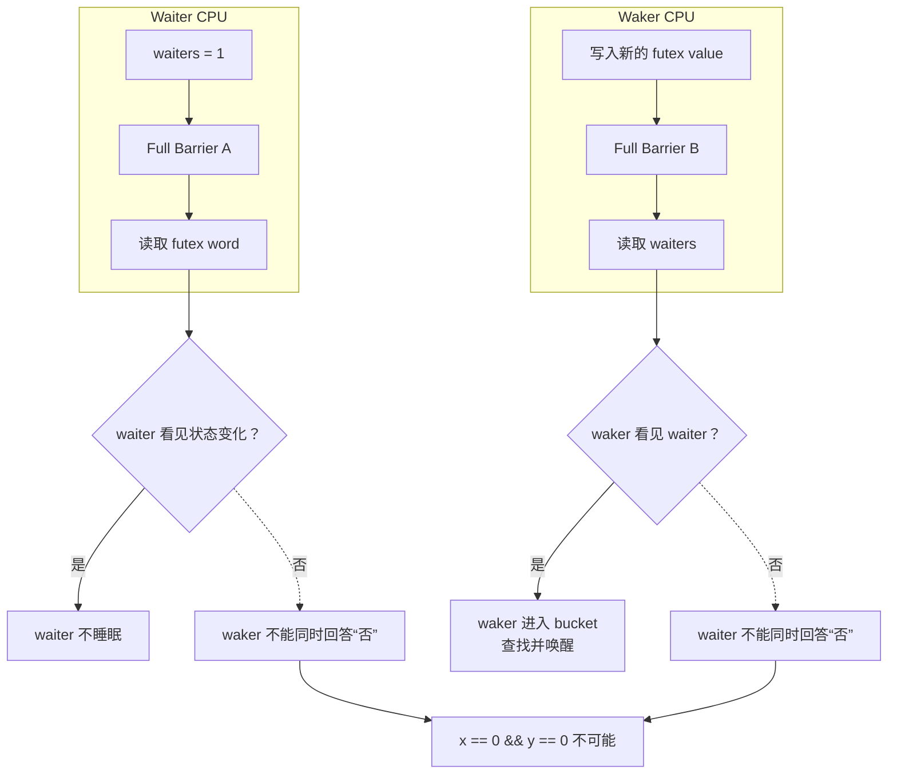

# Linux futex WAIT/WAKE：compare-and-block 如何避免丢唤醒

> 上游仓库：[linux.git](https://git.kernel.org/pub/scm/linux/kernel/git/stable/linux.git/)  
> 分析基线：`v7.2.10`，commit `7b20d05fd38de8e0be168956f6fd241d750c7d69`  
> 验证日期：2026-10-14  
> 分析范围：传统 futex ABI 的 `FUTEX_WAIT` / `FUTEX_WAKE`  
> 不展开：PI futex、requeue、robust futex、futex2 `waitv`

**一句话总结**：futex 不是一把锁，而是把用户态的一个 32-bit 状态字接到内核等待队列上的 `compare-and-block` 原语；它的核心保证是，waiter 要么看到状态已经变化而不睡眠，要么先成为内核可见的 waiter，随后被并发 waker 找到。

## 1. futex 只负责“等待”，不定义锁的状态机

普通 futex word 是用户空间中一个四字节对齐的 32-bit 值。无竞争时，mutex、semaphore 等上层原语只用原子指令修改这个值，完全不进入内核；只有预计需要阻塞或唤醒时，才调用 futex。



因此，内核并不知道这个 word 表示 mutex、semaphore 还是一次性通知，也不负责替用户态修改普通 futex word。`FUTEX_WAIT` 只比较它，`FUTEX_WAKE` 只查找等待同一个 key 的 waiter。

一段简化的用户态协议如下：

```c
// waiter：真正实现必须按上层协议选择原子操作和内存序
for (;;) {
    uint32_t observed = atomic_load_explicit(&state, memory_order_acquire);
    if (condition_is_ready(observed))
        break;

    // 只有 state 仍等于 observed，内核才允许当前线程睡眠。
    // EAGAIN 表示状态已变化，回到循环重新判断即可。
    futex_wait(&state, observed);
}

// waker
atomic_store_explicit(&state, new_state, memory_order_release);
futex_wake(&state, 1);
```

这里有两个不能混淆的层次：

1. futex 的比较负责防止“状态已经变化，线程却刚好睡下”的丢唤醒；
2. 受保护数据的发布与获取仍由上层原子变量的 release/acquire 等内存序负责，不能因为调用了 futex 就省略。

## 2. 系统调用如何进入 WAIT/WAKE

传统 ABI 的入口在 [`kernel/futex/syscalls.c`](https://git.kernel.org/pub/scm/linux/kernel/git/stable/linux.git/tree/kernel/futex/syscalls.c?h=v7.2.10)：

```text
sys_futex(uaddr, op, val, timeout, uaddr2, val3)
  └── do_futex()
        ├── FUTEX_WAIT
        │     val3 = FUTEX_BITSET_MATCH_ANY
        │     └── futex_wait(uaddr, flags, val, timeout, val3)
        └── FUTEX_WAKE
              val3 = FUTEX_BITSET_MATCH_ANY
              └── futex_wake(uaddr, flags, ..., val, val3)
```

普通 `FUTEX_WAIT` 和 `FUTEX_WAKE` 在内核中复用 bitset 版本，mask 固定为 `FUTEX_BITSET_MATCH_ANY`。这里 wait 的 `val` 是期望值；wake 的 `val` 是最多唤醒的 waiter 数。

## 3. 内核按 futex key，而不是裸虚拟地址匹配

`get_futex_key()` 先检查地址是否自然对齐、是否可访问，再生成 `union futex_key`。private 和 shared futex 使用不同身份：

| 类型 | key 的主要组成 | 原因 |
| --- | --- | --- |
| process-private | 当前 `mm`、页内偏移和虚拟地址 | 只需区分同一进程地址空间中的 word，无须解析共享映射 |
| shared、匿名页后端 | `mm`、地址和 `FUT_OFF_MMSHARED` 标志 | 识别以内存对象为身份的共享 word |
| shared file-backed | inode sequence、page offset、页内偏移 | 不同进程中的虚拟地址可以不同，但底层共享对象相同 |

随后 `futex_hash()` 把 key 映射到 `struct futex_hash_bucket`。在启用 `CONFIG_FUTEX_PRIVATE_HASH` 且进程已有 private hash 时，private futex 可以使用进程自己的 bucket 表；否则进入全局、按 NUMA node 分布的 bucket 表。

```c
struct futex_hash_bucket {
    atomic_t waiters;
    spinlock_t lock;
    struct plist_head chain;
};
```

多个不同 futex key 可以哈希到同一个 bucket。正确性不依赖哈希无冲突，因为 wake 扫描 bucket 时还会调用 `futex_match()` 比较完整 key；冲突只会增加锁竞争和扫描成本。



这张图中的三条 `B --> futex_q` 表示同一个 bucket 的链表可以混放不同 key；它不是说一个 waiter 同时属于多把 futex。

## 4. 每个阻塞者都有一个 `futex_q`

普通 `__futex_wait()` 在当前线程的内核栈上创建一个 `struct futex_q`：

```c
struct futex_q {
    struct plist_node list;
    struct task_struct *task;
    spinlock_t *lock_ptr;
    futex_wake_fn *wake;
    union futex_key key;
    u32 bitset;
    // PI、requeue 等字段省略
};
```

关键字段的职责是：

- `list`：挂入 hash bucket 的 `plist`；
- `task`：需要唤醒的任务；
- `key`：从共享 bucket 中筛选真正等待同一 futex 的节点；
- `lock_ptr`：当前保护该节点的 bucket lock，也兼作“已经被 waker 摘除”的发布标志；
- `wake`：普通等待默认指向 `futex_wake_mark()`。

bucket 中的 `plist` 是实现细节：实时线程按优先级排列，普通线程都使用 `MAX_RT_PRIO`，在这个优先级内按 FIFO 排列。但 `FUTEX_WAKE` 的用户态 ABI **不保证具体唤醒哪一个 waiter**，上层同步原语不能依赖当前遍历顺序实现公平性。

## 5. WAIT 路径：先登记意图，再验证值，最后入队

主调用链位于 [`kernel/futex/waitwake.c`](https://git.kernel.org/pub/scm/linux/kernel/git/stable/linux.git/tree/kernel/futex/waitwake.c?h=v7.2.10)：

```text
futex_wait()
  └── __futex_wait()
        ├── futex_wait_setup()
        │     ├── get_futex_key()
        │     ├── futex_hash()
        │     ├── futex_q_lock()
        │     │     ├── hb->waiters++
        │     │     ├── full memory barrier (A)
        │     │     └── spin_lock(hb->lock)
        │     ├── 再读 *uaddr 并与 expected 比较
        │     ├── set_current_state(TASK_INTERRUPTIBLE | TASK_FREEZABLE)
        │     └── futex_queue()：加入 plist 并释放 hb->lock
        ├── futex_do_wait()：必要时 schedule()
        └── futex_unqueue()：判断 wake、timeout、signal 或虚假调度
```

把 WAIT 和并发 WAKE 放进同一条时间线，关键交接如下：



### 5.1 为什么必须在 bucket lock 内重读 futex word

用户态进入系统调用前已经读过一次状态，但这个结果随时会过期。`futex_wait_setup()` 在持有 bucket lock 时重新读取 `*uaddr`：

- 仍等于 `expected`：允许入队；
- 已经变化：撤销 waiter 计数并返回 `-EWOULDBLOCK`，用户态看到 `EAGAIN`；
- 读取地址失败或地址未对齐：返回相应错误。

不能先读值、再获取 bucket lock。否则 waker 可能恰好在两者之间修改状态并完成一次空唤醒，waiter 随后入队并永久睡眠。

### 5.2 为什么先设置任务状态，再放开 bucket lock

确认值仍匹配后，waiter 先执行：

```text
set_current_state(TASK_INTERRUPTIBLE | TASK_FREEZABLE)
queue futex_q
spin_unlock(hb->lock)
```

如果 waker 在 waiter 真正调用 `schedule()` 前就摘除了节点并唤醒它，`futex_do_wait()` 会看到 `q->list` 已空，直接跳过 `schedule()`。因此“已入队但尚未切走”不会丢掉 wake。

## 6. 最关键的正确性：不能同时漏掉状态变化和 waiter

仅靠 bucket lock 仍不足以支持 waker 的无 waiter 快路径。`futex_wake()` 希望在没有等待者时跳过 bucket lock：

```c
if (!futex_hb_waiters_pending(hb))
    return 0;
```

于是产生两个并发观察：

- waiter 要确认用户态 futex word 还没有变化；
- waker 要确认 bucket 没有正在加入或已经加入的 waiter。

Linux 使用 `hb->waiters` 和一对 full memory barrier 建立协议：

```text
Waiter CPU                            Waker CPU
----------                            ---------
hb->waiters++                         *uaddr = new_value
full barrier (A)                      full barrier (B)
lock(hb->lock)                        read hb->waiters
read *uaddr

若值仍等于 expected：                 若 waiters != 0：
  queue futex_q                         lock(hb->lock)
  unlock(hb->lock)                      scan + remove matching q
  schedule()                            unlock(hb->lock)
                                       wake_up_q()
否则：
  hb->waiters--
  返回 EAGAIN
```

两边各自执行“先写、barrier、再读”，禁止双方同时错过对方：



把 `X` 记为 waiter 计数，把 `Y` 记为 futex word，初始均为 0：

```text
Waiter                 Waker
w[X] = 1               w[Y] = 1
MB                     MB
r[Y] = y               r[X] = x
```

成对 barrier 保证 `x == 0 && y == 0` 不可能同时成立。翻译回 futex：

- 如果 waiter 没看到状态变化，它的登记就不能同时被 waker 忽略；
- 如果 waker 没看到 waiter，waiter 就必须看到状态已经变化并拒绝睡眠。

这才是 `FUTEX_WAIT` 所谓“比较与阻塞原子化”的实现基础。它不是把用户内存 load、比较和调度压成一条硬件指令，而是用 waiter 计数、内存屏障、bucket lock 和二次检查组合出同等的逻辑保证。

### 6.1 为什么 waiter 计数要在拿 bucket lock 前增加

waiter 可能正在等待 `hb->lock`，尚未真正进入链表。若等入队后才增加计数，waker 可能先看到计数为 0 并直接返回。因此 `futex_q_lock()` 的顺序是：

```text
waiters++ → barrier → spin_lock(hb->lock)
```

如果后续发现值不匹配或读取失败，`futex_q_unlock()` 会把这次预登记减回去。

## 7. WAKE 路径：锁内摘节点，锁外真正唤醒

完整并发关系已经显示在上一节的时序图中。从 `futex_wake()` 单侧看，源码依次完成：

1. `get_futex_key()` 和 `futex_hash()` 找到 bucket；
2. barrier B 后检查 `hb->waiters`，为 0 时快速返回；
3. 获取 bucket lock，按完整 key 和 bitset 筛选 waiter；
4. 从 `plist` 摘除 `futex_q`，递减 waiter 计数并发布 `lock_ptr = NULL`；
5. 把 task 加入临时 `wake_q`；
6. 释放 bucket lock 后调用 `wake_up_q()`。

### 7.1 为什么在 bucket lock 外 `wake_up_q()`

锁内只完成队列所有权转移：找到节点、从 bucket 摘除、标记已被唤醒，并暂存需要唤醒的 task。真正调用调度器唤醒放在解锁之后，避免把较重的 wakeup 操作放进共享 bucket 的临界区。

### 7.2 `lock_ptr = NULL` 是生命周期交接点

普通 `futex_q` 位于 waiter 的内核栈上。waker 从 bucket 摘除节点后，waiter 可能马上恢复并离开 `__futex_wait()`，从而让这个栈对象失效。

`__futex_wake_mark()` 先执行 `plist_del()`，再用 release store 写入：

```c
smp_store_release(&q->lock_ptr, NULL);
```

源码明确要求：这次 release store 不能跑到摘链操作之前；写成 `NULL` 后，waker 不得再访问 `q`。waiter 随后的 `futex_unqueue()` 看到 `lock_ptr == NULL`，就知道节点已经由 waker 摘除，返回 0 表示正常 wake。

## 8. WAIT 返回后仍必须重查用户态条件

`__futex_wait()` 从 `futex_do_wait()` 返回后调用 `futex_unqueue()`：

| 内核观察 | 结果 |
| --- | --- |
| q 已被 waker 摘除 | 返回 0 |
| q 仍在队列且 timer 到期 | 自行摘除，返回 `ETIMEDOUT` |
| q 仍在队列且有 pending signal | 自行摘除，进入 syscall restart/`EINTR` 语义 |
| q 仍在队列、无 timeout、无 signal | 视为虚假调度，在内核中重新 setup 和等待 |
| setup 时 word 已不等于 expected | 返回 `EAGAIN`，没有睡眠 |

即便 `FUTEX_WAIT` 返回 0，也只说明某次 wake 选中了这个 waiter，不代表：

- 用户态条件现在一定为真；
- 当前线程已经获得 mutex；
- 当前线程是唯一被唤醒的线程；
- 唤醒后状态没有再次变化。

所以用户态必须始终使用 condition loop，醒来后重新读取共享状态。

`FUTEX_WAKE(n)` 的成功返回值是本次从等待队列中选中并交给 wakeup 路径的 waiter 数，不是“已经获得 CPU 的线程数”，更不是“已经获得上层锁的线程数”。

## 9. private 与 shared 的工程边界

如果 futex 只在同一进程的线程之间使用，应传入 `FUTEX_PRIVATE_FLAG`，通常直接使用 `FUTEX_WAIT_PRIVATE` / `FUTEX_WAKE_PRIVATE`：

- private key 只需要当前 `mm` 和虚拟地址信息；
- 不需要解析底层共享映射身份；
- 在支持 private hash 的配置上还能使用进程级 bucket 表。

如果要跨进程等待同一共享内存对象，则不能使用 private flag。此时不同进程可能把同一对象映射到不同虚拟地址，内核必须基于共享对象构造 key。错误地使用 private 操作会让双方得到不同 key，wake 找不到 waiter。

## 10. 这篇没有展开的内容

| 机制 | 为什么单独分析 |
| --- | --- |
| `FUTEX_REQUEUE` / `FUTEX_CMP_REQUEUE` | 涉及两个 bucket、waiter 迁移及额外计数维护，是 condvar 优化的独立主题 |
| PI futex | 引入 owner policy、`rt_mutex` 和优先级继承，不再是无策略的普通 WAIT/WAKE |
| robust futex | 处理 owner 异常退出，需要用户态 robust list 与退出清理协议 |
| futex2 `waitv` | 一次登记多个地址，节点所有权和返回语义不同 |
| glibc pthread mutex/condvar | 上层状态编码、取消、超时和 requeue 策略属于下一阶段 |

## 11. 源码阅读索引

| 问题 | 源码位置 | 关键函数或结构 |
| --- | --- | --- |
| 传统 syscall 分派 | [`kernel/futex/syscalls.c`](https://git.kernel.org/pub/scm/linux/kernel/git/stable/linux.git/tree/kernel/futex/syscalls.c?h=v7.2.10) | `sys_futex()`、`do_futex()` |
| WAIT/WAKE 与 barrier 证明 | [`kernel/futex/waitwake.c`](https://git.kernel.org/pub/scm/linux/kernel/git/stable/linux.git/tree/kernel/futex/waitwake.c?h=v7.2.10) | 文件顶部注释、`futex_wait_setup()`、`futex_wake()` |
| key、hash 和 queue | [`kernel/futex/core.c`](https://git.kernel.org/pub/scm/linux/kernel/git/stable/linux.git/tree/kernel/futex/core.c?h=v7.2.10) | `get_futex_key()`、`futex_hash()`、`futex_q_lock()`、`futex_unqueue()` |
| futex 核心结构 | [`kernel/futex/futex.h`](https://git.kernel.org/pub/scm/linux/kernel/git/stable/linux.git/tree/kernel/futex/futex.h?h=v7.2.10) | `futex_hash_bucket`、`futex_q`、waiter barrier helpers |
| 用户 ABI 常量 | [`include/uapi/linux/futex.h`](https://git.kernel.org/pub/scm/linux/kernel/git/stable/linux.git/tree/include/uapi/linux/futex.h?h=v7.2.10) | `FUTEX_WAIT`、`FUTEX_WAKE`、private variants |

一手语义资料：

- [`futex(2)`](https://man7.org/linux/man-pages/man2/futex.2.html)
- [`FUTEX_WAIT(2const)`](https://man7.org/linux/man-pages/man2/FUTEX_WAIT.2const.html)
- [`FUTEX_WAKE(2const)`](https://man7.org/linux/man-pages/man2/FUTEX_WAKE.2const.html)
- [Linux kernel memory barriers](https://docs.kernel.org/core-api/wrappers/memory-barriers.html)

## 12. 结论

普通 futex 的精巧之处不在于提供了一把更快的内核锁，而在于给用户态同步原语提供了一个窄而可靠的阻塞边界：

1. 用户态原子变量保存真正的同步状态；
2. `FUTEX_WAIT(expected)` 在内核中二次检查，状态变化后不会继续睡眠；
3. waiter 预登记与 waker 空队列快路径之间由成对 full barrier 约束；
4. bucket lock 串行化二次检查、入队和摘队；
5. 先设置任务状态再放锁，允许 wake 发生在真正 `schedule()` 之前；
6. `lock_ptr = NULL` 把节点所有权安全交还给栈上 waiter；
7. 用户态醒来后仍重新检查条件，把策略留在库而不是内核。

后续分析 glibc NPTL mutex 和 condition variable 时，重点就是观察它们如何在这个边界之上编码锁状态、waiter 信息和通知策略。
