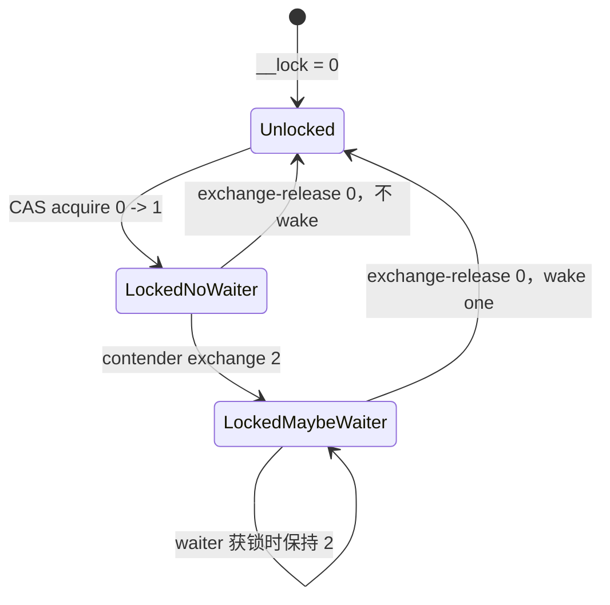

# glibc NPTL mutex：0/1/2 三态如何接入 futex

> 上游仓库：[glibc.git](https://sourceware.org/git/glibc.git)  
> 分析基线：`glibc-2.44`，commit `c3a3a9808ad3ab4a3336836833f83288b672ccbf`  
> 验证日期：2026-10-14  
> 主要平台语境：Linux NPTL；结构布局示例采用 x86-64  
> 分析重点：普通 mutex 的 fast/slow path，以及 recursive、error-check、adaptive 分支  
> 不展开：robust、priority inheritance、priority protect 的完整协议

**一句话总结**：glibc 普通 mutex 用 `__lock` 的 `0/1/2` 三态区分“空闲、无 waiter 持锁、可能有 waiter 持锁”，无竞争时只做用户态 CAS；竞争线程先把状态提升为 2，再通过 `FUTEX_WAIT(2)` 睡眠，unlock 用 release exchange 清零，并且只在旧值大于 1 时 wake 一个 waiter。

## 1. `pthread_mutex_t` 不只有一个 futex word

x86-64 的 `struct __pthread_mutex_s` 定义在 [`sysdeps/x86/nptl/bits/struct_mutex.h`](https://sourceware.org/git/?p=glibc.git;a=blob;f=sysdeps/x86/nptl/bits/struct_mutex.h;hb=glibc-2.44)：

```c
struct __pthread_mutex_s {
    int __lock;
    unsigned int __count;
    int __owner;
    unsigned int __nusers;
    int __kind;
    short __spins;
    short __glibc_reserved;
    __pthread_list_t __list;
};
```

| 字段 | 主要用途 |
| --- | --- |
| `__lock` | 真正参与原子竞争并作为 futex word；普通 mutex 使用 0/1/2，robust/PI 使用另一套位编码 |
| `__count` | recursive mutex 的递归层数 |
| `__owner` | owner TID 或 robust 特殊状态；普通路径也记录 owner，但不靠它取得锁 |
| `__nusers` | 使用者计数，参与销毁等生命周期约束 |
| `__kind` | mutex 类型、process-shared、robust、协议等属性 |
| `__spins` | adaptive mutex 的历史自旋估计 |
| `__list` | robust mutex 链表节点 |

`pthread_mutex_t` 的布局属于 ABI：`__kind` 的位置甚至需要与静态初始化器保持兼容。这也是 glibc 的实现看起来比一个教学 mutex 更复杂的原因之一。

## 2. 普通 low-level lock 的 0/1/2 状态机

[`sysdeps/nptl/lowlevellock.h`](https://sourceware.org/git/?p=glibc.git;a=blob;f=sysdeps/nptl/lowlevellock.h;hb=glibc-2.44) 明确定义了普通 low-level lock：

| `__lock` | 含义 | unlock 是否需要 wake |
| ---: | --- | --- |
| 0 | 未持有 | 不适用 |
| 1 | 已持有，并且已知没有线程阻塞或即将阻塞 | 否 |
| 2 | 已持有，可能存在阻塞或即将阻塞的 waiter | 是，wake 一个 |

状态 2 的措辞是“可能有 waiter”，不是精确 waiter 数量。出现竞争后，即使某一时刻已经没有实际 waiter，锁仍可能暂时保持为 2。这个保守状态换来简单、正确的 wake 判断。



为什么争用后的新 owner 仍然把状态设为 2？因为其他 waiter 可能已经睡在 `FUTEX_WAIT(2)` 上。如果新 owner 把状态降为 1，它稍后 unlock 时会认为没有 waiter，从而跳过 wake。

## 3. 普通 mutex 的 lock fast path

入口在 [`nptl/pthread_mutex_lock.c`](https://sourceware.org/git/?p=glibc.git;a=blob;f=nptl/pthread_mutex_lock.c;hb=glibc-2.44)。普通 mutex 最终进入 `lll_lock()`：

```c
if (CAS_acquire(&__lock, expected = 0, desired = 1) succeeds)
    return;
else
    __lll_lock_wait(&__lock, private);
```

无竞争路径只有一次 `0 -> 1` 的 acquire CAS，没有系统调用。成功后 `pthread_mutex_lock()` 再记录：

```text
__owner = current TID
__nusers++
```

这里的 acquire 与 unlock 的 release 配对，使前一个 owner 在临界区中的写入对新 owner 可见。futex 只负责必要时睡眠，临界区的内存同步依赖取得/释放 `__lock` 的原子内存序。

### 3.1 单线程优化为什么只适用于 private mutex

glibc 在进程仍为单线程、mutex 是 process-private 且 `__lock == 0` 时，可以直接写：

```c
mutex->__data.__lock = 1;
```

process-shared mutex 即使当前进程只有一个线程，仍可能被另一个进程竞争，所以不能使用这个优化。已经持有的 normal mutex 也不能直接覆盖，否则会破坏“重复加锁应阻塞”的语义。

## 4. slow path：先宣布“可能有 waiter”，再睡在值 2 上

slow path 位于 [`nptl/lowlevellock.c`](https://sourceware.org/git/?p=glibc.git;a=blob;f=nptl/lowlevellock.c;hb=glibc-2.44)：

```c
if (atomic_load_relaxed(futex) == 2)
    goto wait;

while (atomic_exchange_acquire(futex, 2) != 0) {
wait:
    futex_wait(futex, 2, private);
}
```

这段循环同时完成两件事：

1. `exchange(2)` 把“可能有 waiter”写进共享状态；
2. 如果 exchange 读到 0，当前线程已经获得锁，但仍保留状态 2，以便之后的 unlock 继续唤醒其他潜在 waiter。

典型竞争时序：

```text
Owner                         Contender
-----                         ---------
__lock = 1
                              CAS 0 -> 1 失败
                              exchange-acquire(__lock, 2) 返回 1
                              FUTEX_WAIT(&__lock, 2)
exchange-release(__lock, 0)
旧值为 2 -> FUTEX_WAKE(1)
                              醒来
                              exchange-acquire(__lock, 2)
                              若读到 0，则取得锁
```

`FUTEX_WAIT(2)` 仍然会在内核中二次检查。如果 owner 已经把值改成 0，wait 返回 `EAGAIN`，contender 直接回到 exchange 重试，不会睡过一次 unlock。

## 5. unlock：清零是 release 点，wake 是条件动作

普通路径位于 [`nptl/pthread_mutex_unlock.c`](https://sourceware.org/git/?p=glibc.git;a=blob;f=nptl/pthread_mutex_unlock.c;hb=glibc-2.44)。在清理 `__owner` 和 `__nusers` 后，`lll_unlock()` 执行：

```c
int old = atomic_exchange_release(&__lock, 0);
if (old > 1)
    futex_wake(&__lock, 1, private);
```

因此：

- `1 -> 0`：明确没有 waiter，不进入内核；
- `2 -> 0`：可能有 waiter，wake 一个；
- wake 前必须先发布 0，否则被唤醒线程仍会看到锁被持有。

unlock 还体现了一个容易忽略的生命周期约束：`private` 等后续需要的信息必须在 release 之前取出。另一个线程取得锁后，可能立刻销毁并复用 mutex 内存；unlock 不能在发布 0 之后继续读取对象字段。

## 6. 为什么状态 2 不能被理解为 waiter 数量

以下竞态会产生“状态为 2，但暂时没有睡眠线程”：

1. contender 写入 2；
2. owner 清零并 wake，但 contender 尚未进入内核或 `FUTEX_WAIT` 返回 `EAGAIN`；
3. contender 用 exchange 取得锁，并继续保持 2。

这不是错误。状态 2 表示 unlock 不能安全省略 wake，而不是“内核队列长度大于 0”。保守地多做一次空 `FUTEX_WAKE`，比把 2 降为 1 后漏掉仍在睡眠的 waiter 安全得多。

## 7. mutex 类型如何复用或改变这条主线

### 7.1 Recursive mutex

如果 `__owner` 已经等于当前 TID，recursive mutex 不再竞争 `__lock`，只增加 `__count`。unlock 递减计数，只有降到 0 才真正释放 low-level lock。计数溢出返回 `EAGAIN`。

### 7.2 Error-check mutex

再次由 owner 加锁时返回 `EDEADLK`；非 owner unlock 返回 `EPERM`。检查依赖 `__owner`，真正的互斥仍由 `__lock` 完成。

### 7.3 Adaptive mutex

第一次 trylock 失败后，adaptive mutex 不立即 futex wait，而是：

1. 根据 `__spins` 和平台上限决定预算；
2. 使用指数退避加随机 jitter 自旋；
3. 在每轮观察到锁可能空闲时再 trylock；
4. 超出预算才进入普通 `lll_lock()`；
5. 用本次自旋次数的 1/8 误差更新历史 `__spins`。

它优化的是“owner 正在其他 CPU 上运行且临界区很短”的场景；如果 owner 已被抢占或竞争持续，自旋只会浪费 CPU。

### 7.4 Condition-variable 专用 lock 路径

`lowlevellock.h` 还提供 `lll_cond_lock()`，它从一开始就把状态设为 2，而不是 1。源码说明这是为 condvar broadcast/requeue 历史优化保留的语义：必须保留“可能有 waiter”，避免后续 unlock 跳过 wake。它说明同一个 mutex 对象在 condition wait 相关内部路径中可能采用更保守的状态。

### 7.5 Robust、PI 与 priority-protect

这些类型不再只是 0/1/2：

- robust mutex 在 `__lock` 中编码 owner TID、`FUTEX_WAITERS`、`FUTEX_OWNER_DIED`，并接入 robust list；
- PI mutex 使用 `FUTEX_LOCK_PI` / `FUTEX_UNLOCK_PI`，把 owner 与优先级继承交给内核 `rt_mutex`；
- priority-protect mutex 还编码 priority ceiling 并调整线程优先级。

它们与普通 mutex 共享 `pthread_mutex_t` 外观，但正确性协议已经不同，不应拿 0/1/2 直接解释。

## 8. 公平性与惊群边界

普通 unlock 调用 `FUTEX_WAKE(1)`，避免 wake-all 惊群。但这不等于公平：

- 新到线程可以在已唤醒 waiter 真正运行前先完成 `0 -> 1`；
- futex ABI 不承诺选择哪个 waiter；
- glibc 普通 mutex 没有 ticket 或直接 handoff。

因此它是 competitive handoff：unlock 发布空闲状态后，所有能观察到 0 的线程都可能竞争，新 owner 不一定是刚被唤醒的 waiter。

## 9. 与 Linux futex 的接口契合

0/1/2 协议正好使用了普通 futex 的两个能力：

```text
glibc                         Linux kernel
-----                         ------------
CAS/exchange 维护 0/1/2       不理解 mutex 状态含义
FUTEX_WAIT(expected=2)  ────>  值仍为 2 才入队阻塞
release exchange 2 -> 0       用户态先发布解锁
FUTEX_WAKE(1)           ────>  从匹配 key 的 waiter 中最多唤醒一个
```

glibc 用状态 2 决定“是否可能需要系统调用”；内核用 compare-and-block 保证这个判断与入队之间不丢唤醒。两边各自只承担一半协议。

## 10. 源码阅读索引

| 问题 | 源码位置 |
| --- | --- |
| mutex 类型分派和 fast path | [`nptl/pthread_mutex_lock.c`](https://sourceware.org/git/?p=glibc.git;a=blob;f=nptl/pthread_mutex_lock.c;hb=glibc-2.44) |
| unlock 和各类型释放路径 | [`nptl/pthread_mutex_unlock.c`](https://sourceware.org/git/?p=glibc.git;a=blob;f=nptl/pthread_mutex_unlock.c;hb=glibc-2.44) |
| 0/1/2 状态定义与 lock/unlock 宏 | [`sysdeps/nptl/lowlevellock.h`](https://sourceware.org/git/?p=glibc.git;a=blob;f=sysdeps/nptl/lowlevellock.h;hb=glibc-2.44) |
| futex slow path 循环 | [`nptl/lowlevellock.c`](https://sourceware.org/git/?p=glibc.git;a=blob;f=nptl/lowlevellock.c;hb=glibc-2.44) |
| x86 mutex ABI 布局 | [`sysdeps/x86/nptl/bits/struct_mutex.h`](https://sourceware.org/git/?p=glibc.git;a=blob;f=sysdeps/x86/nptl/bits/struct_mutex.h;hb=glibc-2.44) |
| glibc futex 包装及其生命周期约束 | [`sysdeps/nptl/futex-internal.h`](https://sourceware.org/git/?p=glibc.git;a=blob;f=sysdeps/nptl/futex-internal.h;hb=glibc-2.44) |

## 11. 结论

glibc 普通 mutex 的关键设计可以压缩成四步：

1. 无竞争时用 acquire CAS 把 `0 -> 1`；
2. 竞争时把状态提升为 2，再等待 `FUTEX_WAIT(2)`；
3. 被唤醒后仍通过 exchange 竞争所有权，取得锁时保持 2；
4. unlock 用 release exchange 清零，旧值大于 1 才 `FUTEX_WAKE(1)`。

这套状态机不精确计算 waiter，只回答一个更便宜的问题：释放时能否确定不需要 wake。它以少量可能的空 wake 换取无竞争路径只有一次用户态原子操作，也把公平性留给调度与竞争，而不是在 mutex 中维护严格队列。
